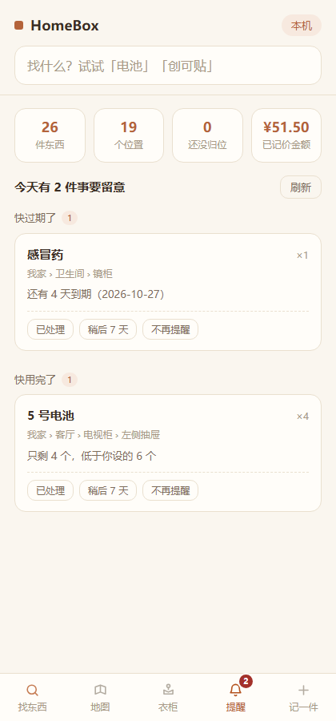

# HomeBox

一个跑在家里局域网的收纳检索工具。核心目的只有一个：**想找东西的时候，一秒查到它在哪。**

技术上刻意做得极简——零依赖（只用 Node 内置模块）、单文件数据库、没有构建步骤。可以拷到任何一块树莓派、香橙派或者旧笔记本上跑起来，装好之后家里所有设备都能用。

## 它能做什么

| | |
| --- | --- |
| **一秒找到东西** | 搜关键词，直接告诉你 `客厅 › 电视柜 › 左侧抽屉`，并且列出这个柜子里还有什么 |
| **家的地图** | 俯视平面图，家具位置可以自己拖，颜色深浅代表那里塞了多少东西；点进一件家具能看到它内部每个抽屉 |
| **衣柜** | 「今天穿什么」自动搭一套，优先推荐最近穿得少的；按季节 / 颜色 / 类别筛选 |
| **物品照片** | 说得出样子叫不出名字的东西，拍张照，找的时候看一眼图 |
| **加到手机桌面** | 安卓「添加到主屏幕」、iPhone 分享菜单，加完跟原生 App 没差别，全屏、无地址栏 |
| **谁的东西、值多少钱** | 每件东西可记归属人和购入价；概览页按位置 / 类目 / 人三个维度看金额，分「在库价值」和「累计购入」两个口径，并告诉你还有多少件没记价 |
| **一家人各有各的视角** | 四档身份：管理员管人和设置，成员正常记东西，精简档给老人用（看不到金额、也没有删除按钮），访客只能查 |
| **该操心的东西会自己找你** | 给药品食品填个过期日、给耗材填个最低库存，首页「提醒」页签会列出来，还能每天发一封邮件汇总到你的邮箱 |
| **每天自动备份** | 每天凌晨三点导出一份 JSON，留 7 份；接了 NAS 就自动再复制一份过去，留 30 份 |
| **拍张照就记好了** | 说得出样子叫不出名字？拍一张，自动填好名称、类目和大概位置。默认关闭，开了才会把照片发出去 |

所有数据只存在你自己家里的那台机器上，不经过任何服务器。

## 看起来像这样

| 搜索：一秒找到东西在哪 | 家的地图：可视化收纳 |
| --- | --- |
|  |  |

| 衣柜：今天穿什么 | 提醒：过期与快用完 |
| --- | --- |
|  |  |

## 快速开始（先在电脑上试一下）

只需要 Node 22.13 以上，不用装任何依赖、不用打包（数据库用的是 Node 自带的 `node:sqlite`）：

```bash
git clone https://github.com/1606701/HomeBox.git
cd HomeBox
node server.js
```

然后打开 <http://127.0.0.1:8080>。第一次启动会自动生成 `data/homebox.db`，里面有一份示例数据，随便改。

> 从旧版本升级上来的话，`data/db.json` 会在启动时自动迁移进 `data/homebox.db`，
> 原文件改名为 `db.json.migrated` 留档、不删除，迁移脚本还会额外在 `data/backup/` 里存一份。
> 想手动跑迁移和看验收报告：`npm run migrate`。

想让同一个 WiFi 下的手机也访问：

```bash
# macOS / Linux
HOST=0.0.0.0 node server.js

# Windows PowerShell
$env:HOST="0.0.0.0"; node server.js
```

控制台会打印地址，手机浏览器访问 `http://你的电脑IP:8080` 即可。

> 换端口用 `PORT=3000 node server.js`。默认只监听 `127.0.0.1`（只有本机能访问），这是刻意的——要开放给局域网必须显式声明 `HOST=0.0.0.0`。

## 装到树莓派 / 香橙派上

这部分两台机器完全通用，区别只有用户名（树莓派默认是 `pi`，香橙派默认是 `orangepi`）。

### 1. 确认 Node 版本

```bash
node -v
```

**必须是 v22.13 以上。** 这是 v2 的硬门槛：数据库用的是 Node 内置的 `node:sqlite`，22.13 之前要么没这个模块、要么还得加 `--experimental-sqlite` 才能用。
这里有两个坑：Debian 旧版本（bullseye）用 `apt install nodejs` 装出来的是 v12；就算比较新的源，默认也常常是 v18/v20 —— 都不够。

够新就直接装：

```bash
sudo apt update
sudo apt install -y nodejs
```

版本太旧或者还没装，用 NodeSource 拿一个正式的 LTS：

```bash
curl -fsSL https://deb.nodesource.com/setup_lts.x | sudo -E bash -
sudo apt install -y nodejs
node -v   # 必须是 v22.13 以上，v22.x 或 v24.x 都行
```

### 2. 把代码放上去

```bash
git clone https://github.com/1606701/HomeBox.git ~/HomeBox
cd ~/HomeBox
```

没有 git 或者网络不通，也可以在本机打包后用 scp 传：

```bash
scp -r HomeBox orangepi@192.168.1.50:~/
```

### 3. 跑起来

```bash
cd ~/HomeBox
HOST=0.0.0.0 PORT=8080 node server.js
```

此时家里任意设备打开 `http://192.168.1.50:8080` 就能用。

**建议去路由器里给这台机器绑一个静态 IP**（一般在 DHCP 静态地址分配里按 MAC 绑定），否则某天重启后 IP 变了，手机上的快捷方式就打不开了。

如果打不开，多半是被防火墙挡了，放行一下端口：

```bash
sudo ufw allow 8080/tcp   # 用了 ufw 的话
```

### 开机自启

新建 `/etc/systemd/system/homebox.service`：

```ini
[Unit]
Description=HomeBox 家庭收纳
After=network.target

[Service]
Type=simple
User=orangepi
WorkingDirectory=/home/orangepi/HomeBox
Environment=HOST=0.0.0.0
Environment=PORT=8080
ExecStart=/usr/bin/node server.js
Restart=always
RestartSec=3

[Install]
WantedBy=multi-user.target
```

然后：

```bash
sudo systemctl daemon-reload
sudo systemctl enable homebox
sudo systemctl start homebox
sudo systemctl status homebox
```

两个容易踩的点：

- `User=` 和 `WorkingDirectory=` 要换成你自己的用户名（树莓派是 `pi`，香橙派是 `orangepi`）。
- `ExecStart=` 的路径可能不是 `/usr/bin/node`，用 `which node` 查一下实际位置再填。

日常这几条够用了：

```bash
sudo systemctl restart homebox     # 改完代码重启
sudo journalctl -u homebox -f      # 看实时日志
sudo systemctl stop homebox        # 停掉
```

### 升级

> **从 v1 升到 v2 之前，先确认 `node -v` ≥ 22.13。** 否则升级完会直接起不来（`Cannot find module 'node:sqlite'`）。
> 升级后第一次启动会**自动把 `data/db.json` 迁进 `data/homebox.db`**：原文件改名为 `db.json.migrated` 留档，另在 `data/backup/` 存一份。迁移有 8 条校验，不过就回滚，不会半途留下一份坏库。
> 想先看看会发生什么，可以只跑 `npm run migrate`（它只迁移、不启动服务，会打印验收报告）。

代码更新不会影响你的数据（数据在 `data/` 里，不在版本库里）：

```bash
cd ~/HomeBox
git pull
sudo systemctl restart homebox
```

### 加到手机桌面

- **安卓 / Chrome**：打开页面，右上角菜单里选「添加到主屏幕」，之后图标和原生 App 几乎一样。
- **iPhone / Safari**：分享按钮 → 「添加到主屏幕」。

加完之后，找东西就是：解锁 → 点图标 → 输入关键词。

## 自动备份

**从 v2 P3 起，服务自己每天凌晨三点备份一次**：导出到 `data/backup/`，留 7 份。如果你在设置页填了「备份位置」（比如挂载好的 NAS 目录），它会再复制一份过去，留 30 份。

这一步不是「防止误删」，而是**防 TF 卡坏掉**——所以「备份到同一张卡上等于没备份」这句话仍然成立。设置页里没填外部目录时，每天那封摘要邮件底部会附上「怎么接 NAS」的三步说明。

手工备份的做法仍然保留：

数据在 `data/` 目录里：`homebox.db`（SQLite）+ `photos/`（照片文件）。
**数据库跑在 WAL 模式，服务运行中直接 `tar data/` 可能拷到半新半旧的状态**，所以日常备份走第一种做法。

### 做法一（推荐，不用停服务）：导出成 JSON

`npm run export` 会走和线上同一个连接读库，先跑 `PRAGMA integrity_check` 再落盘，
导出的是一份人类可读、可回灌的 JSON。**目标目录要在 `data/` 树外**，否则会被别的备份动作再套一层。

```bash
crontab -e
# 每天 03:00 导出到树外目录（目录不存在会自动建；也可以写一个具体的 .json 文件名）
0 3 * * * cd /home/orangepi/HomeBox && /usr/bin/npm run export -- --out /home/orangepi/backup
```

不写 `--out` 时默认落在 `data/backup/`，那个位置只适合**手动临时导出**，别拿它当定时备份目标。

> `--out` 的判定规则很简单：**带 `.json` 后缀就当文件名，其它一律当目录**（不存在会自动创建，
> 文件名自动取 `homebox-<时间戳>.json`）。所以 `--out ./backup` 会在 `backup/` 目录里生成一个带时间戳的文件，
> 想要固定文件名就写全 `--out ./backup/homebox.json`。

照片不在 JSON 里（JSON 只记文件名），要另外同步一份：

```bash
0 3 * * * cd /home/orangepi/HomeBox && rsync -a data/photos/ /home/orangepi/backup/photos/
```

保留最近 30 天：

```bash
0 4 * * * find /home/orangepi/backup -name 'homebox-*.json' -mtime +30 -delete
```

### 做法二（需要整库快照时才用）：停服务后打包整个 `data/`

**必须先停服务**，再打包，否则 WAL 里可能还有没回写的数据；`.db` 和 `-wal` / `-shm` 要一起拷：

```bash
systemctl stop homebox 2>/dev/null || pkill -f 'node server.js'
tar czf /home/orangepi/backup/homebox-$(date +%Y%m%d).tar.gz data/
node server.js &
```

> 注意：要真正安全，备份的目标位置不能和源在同一块卡上。香橙派的 TF 卡是整个系统里最可能先坏的东西，建议拷到 NAS、U 盘或者干脆 rsync 到你的电脑。
>
> 加了照片之后 `data/` 会明显变大。照片只增不减，用 `rsync -a` 只传变化的部分最省。

## 给物品加照片

找东西时经常说得出样子、叫不出名字，这时候一张照片顶十句描述。

「记一件」和衣柜的「添一件衣服」里都有照片区：

- **拍照**：直接叫起手机后置摄像头（`capture="environment"`）。
- **从相册选**：从已有照片里挑。
- 选好之后会先显示预览，确认没问题再保存。列表里每张卡片左边会出现缩略图，**点一下看大图**。

几个实现上的取舍：

**图片在前端就先压缩过。** 手机直出的照片动辄三四千像素、好几 MB，浏览器会先把它画到 canvas 上缩到长边 1280 再转成 JPEG（质量 0.82），通常能压到原来的十分之一以下，肉眼看不出差别，但香橙派的 TF 卡会轻松很多。

**图片存独立文件，不塞进数据库。** 文件放在 `data/photos/` 下，数据库里只留一个文件名。这样数据库不会被几千张图撑大到读不动，备份时也好分别处理。

**服务端不看文件名，直接读文件头判断图片类型。** 即使有人把一段脚本改名成 `.jpg` 传上来也会被拒掉，只认真正的 jpg / png / webp。单张超过 6MB、或整个请求超过 9MB 会被拒绝并给出提示。

**换照片会删掉旧的，删物品也会连带删照片**，不会在卡里留下一堆孤儿文件。

> **关于拍照按钮**：`<input type="file">` 在 HTTP 页面里是能调起摄像头的，但各家浏览器对「直接拍照」的限制一直在变。如果发现「拍照」按钮没反应，**用「从相册选」一定可以**——先在系统相机里拍，再进相册选这张。想让拍照始终可靠，可以给香橙派配个 HTTPS（Tailscale 加自签证书是最省事的路子）。

### 改完代码，前端没变化怎么办

浏览器有 Service Worker 缓存，**曾经吃过一次亏**：旧版本的 SW 会一直把它的 `app.js` 还给你，部署了新功能却死活看不到。

现在做了三重保险，正常情况刷新一次就会自动更新。但如果还是怀疑上了旧版本，**看页面最下面那行小字**——那里写着当前的前端资源版本（比如 `前端资源 v6`）。只要它不是你要的版本，按 `Ctrl+Shift+R`（Mac 是 `Cmd+Shift+R`）硬刷新一次即可，开无痕窗口也一定能拿到最新的。

> **改动前端后的发布约定**：`public/index.html` 里引用的 `style.css?v=N` 和 `app.js?v=N`，以及 `public/app.js` 顶部的 `APP_VERSION`，三者必须同步 +1。漏掉这一步，浏览器可能继续用缓存里的旧资源。

## 按自己家的样子改户型

示例数据里的「一房一厅」只是个起点，**户型是完全可编辑的**，不是写死的模板。

在「地图」页点右上角 **编辑户型**：

| 想做什么 | 怎么操作 |
| --- | --- |
| 加房间 | 点「+ 加房间」，它会自己找个空位落下，然后在下面的面板里改成你要的名字 |
| 加家具 / 收纳位 | 选中一个房间后点「+ 加家具」，会落在这个房间里 |
| 改名字 | 在地图上点中它，在下面的面板里改，点保存 |
| 改大小 | 拖它右下角的方块，或者在面板里直接填宽高 |
| 挪位置 | 按住拖到想去的地方，松手自动保存 |
| 挪到别的房间 | 直接把家具拖到另一个房间上，松手后归属会自动改过去 |
| 删掉 | 选中后点面板里的「删除」。里面的东西不会被删，只是变成「未归档」 |
| 格子改名 / 删除 | 编辑模式下点进家具内部，点某个格子即可改名，角上的 × 是删除 |

上方的「户型尺寸」用来填**家的实际宽度（米）**，填完之后每个房间会显示真实面积（比如 18 ㎡）。这个数字只影响面积换算，不影响任何功能。

坐标记在 `location.box` 里，是一套 100 × 88 的相对坐标，房间和家具共用，所以拖出来的比例就是你看图的比例。

## 数据说明

数据存在 `data/homebox.db`（SQLite）里。不想装数据库客户端也能看：导出成 JSON 就行。

```bash
npm run export          # 写到 data/backup/homebox-<时间戳>.json，结构如下
```

```json
{
  "version": 2,
  "settings":  { "planWidthM": 12 },
  "locations": [{ "id": "l_living", "name": "客厅", "parent": "l_home",
                  "kind": "room", "box": { "x": 4, "y": 4, "w": 44, "h": 44 } }],
  "items":     [{ "id": "i_xxx", "name": "指甲刀", "locId": "l_tvdrawer", "qty": 1, "tags": ["工具"] }]
}
```

`locations` 通过 `parent` 串成一棵树，`items.locId` 指向这棵树上的某个节点。`kind` 有四种：`home`（家）／`room`（房间）／`furniture`（家具）／`compartment`（抽屉、隔层这类格子）。

衣服不单独建表，是普通物品多挂了一个 `wear` 字段（`{ type, seasons, colors, size, status, wearCount, lastWorn }`，库里存成 JSON 列）。这样衣服也能被全局搜索到，位置逻辑完全复用。

有照片的物品会多一个 `photo` 字段，值是 `data/photos/` 下的文件名：

```json
{ "id": "i_xxx", "name": "指甲刀", "locId": "l_tvdrawer", "photo": "p_ab12cd.jpg" }
```

服务器每次写入都采用「先写临时文件再改名」的原子操作，避免写到一半断电把文件写坏。照片不属于关键数据（写坏了重新拍一张就是），所以是直写的，不做这层保护。

## 接口

| 方法 | 路径 | 说明 |
| --- | --- | --- |
| GET | `/api/locations` | 返回位置树（每节点带 `itemCount` / `totalCount`）与 `settings` |
| POST | `/api/locations` | 新建位置，body：`{ name, parent, kind }`。房间和家具会自动分配可见的初始坐标 |
| PUT | `/api/locations/:id` | 更新 `name` / `box` / `parent` / `kind`。改 parent 会做防环校验 |
| DELETE | `/api/locations/:id` | 删除位置及其子位置，其中的物品降级为「未归档」 |
| PUT | `/api/settings` | 更新 `{ planWidthM }`，用于面积换算 |
| GET | `/api/items?q=关键词` | 搜索物品，每项带完整路径 `path` |
| POST | `/api/items` | 新增物品，body：`{ name, locId, qty, tags, note, wear }` |
| PUT | `/api/items/:id` | 更新物品。不带 `wear` 字段时不会动到衣物属性 |
| DELETE | `/api/items/:id` | 删除物品（连带删掉它的照片文件） |
| POST | `/api/items/:id/photo` | 上传照片，body：`{ data: "<base64 或整条 dataURL>" }`。服务端按文件头判断类型，落在 `data/photos/` 下 |
| DELETE | `/api/items/:id/photo` | 只删照片，物品保留 |
| GET | `/photos/:文件名` | 取照片本体，带一年长缓存（离线也能看） |
| GET | `/api/wardrobe` | 全部衣物 + 各维度分面统计 |
| GET | `/api/wardrobe/suggest?season=` | 按季节推荐一套搭配，优先推最近少穿的 |
| POST | `/api/items/:id/wear` | 记录「今天穿了」，默认转为待洗；`{ undo: true }` 可撤销 |
| POST | `/api/wardrobe/demo` | 一键导入示例衣物，按现有位置结构柔性匹配 |
| GET | `/api/auth/me` | 当前身份、可做/不可做哪些事、成员名单（点头像登录要用） |
| POST | `/api/auth/setup` | 建第一个管理员（已有成员时 409）。返回的恢复码只出现这一次 |
| POST | `/api/auth/login` | 登录：管理员校验密码，其他成员点头像即进 |
| POST | `/api/auth/logout` | 退出 |
| GET/POST | `/api/members` | 成员列表 / 新建成员（仅管理员） |
| PUT/DELETE | `/api/members/:id` | 改名改角色 / 删除（最后一个管理员删不掉、降不了级） |
| POST | `/api/members/:id/password` | 设密码，会让该成员所有旧登录立即失效 |
| GET | `/api/stats/value?by=loc\|category\|owner` | 金额统计：两个口径 + 覆盖率 + 三个维度分组 |

> 金额字段：`items.price_cents`（整数分，未填是 `null` 而不是 0）、`buy_date`、`owner_id`、`category`、`state`。
> 没有 `seePrice` 权限的角色，响应里**根本不会出现** `priceCents` / `valueCents` / `buyDate` 这几个 key —— 裁剪在服务端做，不是前端藏起来。

**提醒、邮件与备份（P3）**

| 方法 | 路径 | 说明 |
| --- | --- | --- |
| GET | `/api/reminders` | 今天该关心的事，四类分组（过期 / 低库存 / 借出未还 / 闲置） |
| POST | `/api/reminders/:itemId/:kind/ack` | `done`（今天不再提）/ `snooze`（7 天后）/ `mute`（永久不提） |
| GET/PUT | `/api/notify/settings` | 邮件与备份配置。**授权码只进不出**，读接口只回 `hasPass` |
| POST | `/api/notify/test` | 发一封测试邮件，同步返回 SMTP 原始错误 |
| GET | `/api/jobs/status` | 今天的备份/邮件任务结果、最近一封邮件状态 |
| POST | `/api/jobs/run` | 手动跑一次（`daily` 或 `backup`） |
| GET | `/api/backup/status` | 备份份数、最近时间、外部目录是否可写 |
| POST | `/api/backup/run` | 立即备份一次 |
| POST | `/api/backup/probe` | 检测某个目录能不能写（设置页那个按钮） |

物品侧新增字段：`expire_at`（YYYY-MM-DD）、`remind_days`（提前几天）、`min_qty`（最低库存）、`lend_to` / `lend_at`（借出）。
这些字段**默认为空，空值一律不进提醒** —— 所以升级当天不会被几十件没填日期的旧物品轰炸。

**拍照识别与数据搬运（P4）**

| 方法 | 路径 | 说明 |
| --- | --- | --- |
| GET | `/api/ai/status` | 能不能识别（前端据此决定渲不渲染拍照按钮） |
| POST | `/api/vision/recognize` | 传一张图，返回预填草稿。未启用时 404；失败时 200 + `unavailable` |
| GET | `/api/export` | 导出完整 JSON（带 `Content-Disposition`，浏览器直接下载） |
| POST | `/api/import` | 回灌，**必须带 `confirm:"REPLACE"`**，动手前自动备份 |

### 拍照识别怎么开

默认是**关的**，因为这一步会让照片离开你家。要开的话：

1. 找一家 OpenAI 兼容的视觉模型服务（默认预设是智谱，`glm-4v-flash` 永久免费；通义 `qwen-vl-plus` 也行）。
2. 设置页 → 拍照识别 → 选服务商 → 填 API Key → **把「启用拍照识别」开关打开** → 保存。
3. 回到「记一件」，名称下面会多出一个「拍照识别」按钮。拍完它会把名称、类目、标签、大概位置填好，**你确认无误再点保存**。

> **为什么默认是 `glm-4v-flash` 而不是更新的 `glm-4.6v-flash`**：实测 4.6v-flash 在高峰期频繁回
> `1305 该模型当前访问量过大`，而且它会先「思考」十几秒（`reasoning_content`），经常超过超时。
> 4v-flash 是老一代，但 2～3 秒就能回来、长期免费、输出也稳定。想试新的，把模型名改成
> `glm-4.6v-flash` 即可，代码里把它放在备用位，主模型排队时会自动切过去。

几个刻意的取舍：

- **没配 Key 时按钮根本不存在**，不是点了才报错。
- 照片在浏览器里先压到**长边 720** 再发，比 1280 省一半 token，识别一样准。
- 6 秒超时；超时、限流、模型返回胡话，都只弹一行灰字，表单照常能手动填完。
- 模型给的结果只当**建议**：类目不在那 8 类里就归「其他」，位置名不在你的房间列表里就丢掉，名称超长会截断。
- 服务端不落盘、不写日志，图片只在内存里转发一次。

> 月成本量级：一次识别约 ¥0.002，免费档为 0。一家四口每月几十次，基本可以忽略——真正的成本是「识别不准让你多打几个字」，所以它永远只是加速器。

### 邮件怎么配（QQ 邮箱为例）

1. 网页版 QQ 邮箱 → 设置 → 账户 → 找到「POP3/IMAP/SMTP 服务」→ 开启 → **生成授权码**（那串 16 位字符，不是登录密码）。
2. 在 HomeBox 里：右上角「身份」→ 设置 → 服务器选「QQ 邮箱」（自动填 `smtp.qq.com:465`）→ 填邮箱、授权码、收件邮箱 → 保存。
3. 点「发一封测试邮件」。第一次很可能进垃圾箱，去垃圾箱里把它标成「非垃圾」。

> **注意**：发件人必须等于你登录的那个邮箱，否则 SPF 不过，会被直接判垃圾。所以这个版本不支持「用 A 邮箱发、显示成 B 发件人」。
> 家用宽带的 25 端口普遍被封，所以只支持 465（隐式 TLS）和 587（STARTTLS）两种，配置页也只给这两个。
>
> 提醒默认在每天 08:30 汇总一封；21:00–08:00 不发；断电重启只补最近一次，**不会一次补发好几封**；同一件东西同一类提醒 7 天内只发一次。

有了这套接口，后面想做别的前端（比如一个真正的鸿蒙原生 App）只需要连它就行，数据层不用重写。

## 还能往哪走

v2 已经把原计划里的大半做掉了：提醒（过期 / 库存 / 借出）、每日邮件、自动备份、金额统计、拍照识别都已在里面。
剩下这些是按「先解决真问题，再加装饰」排的：

1. **二维码**：把每个收纳位置的链接生成二维码贴在柜门上，扫一下直接列出这个柜子里有什么。对「站在柜子前面找东西」这个场景，比翻树快得多。
2. **本地图像识别**：现在的识别走云端（照片会出家门一次）。香橙派 AI Pro 那块昇腾 NPU 还闲着，接本地模型后照片可以完全不出家门——代价是要折腾 CANN/OM 工具链。
3. **外网访问**：装个 Tailscale，比端口映射安全得多，顺带解决 http 下 Cookie 不能标 Secure 的问题。
4. **3D 微缩视图**：最后再考虑。视觉效果好，但对「找东西」的实际帮助不如搜索和二维码。

## 安全提醒

从 v2 起有了**轻量身份**：管理员设密码，其他成员点头像就能进，登录状态保留 7 天。

但请把预期放对——**这套东西防的是家人误操作和访客看金额，不防局域网里的攻击者**：

- 默认是 `http://192.168.x.x`，流量没加密，同一个 WiFi 下有本事抓包的人能拿到登录 Cookie。所以 Cookie 不能标 `Secure`（标了全家都登不上），这是刻意的取舍。
- 密码只要求 6 位以上，不折腾复杂度——家庭场景的敌人是「记不住」，不是爆破（哈希用的是 `scrypt`，离线爆破也很慢）。
- 忘记密码没有邮箱找回，只能在机器上跑 `node scripts/reset-password.js <名字>`，或者用建管理员时给出的恢复码。

**请不要把它端口映射到公网。** 确实要在外面访问，用 Tailscale——它顺带解决了 HTTPS，那时 Cookie 会自动带上 `Secure`。

刚升级上来第一次打开会要求「建一个管理员」（也可以点「先跳过」保持本机全权限）。这一步只出现一次。

## 项目结构

```
HomeBox/
├── server.js          # HTTP 服务、路由分派、静态资源、启动
├── lib/
│   ├── db.js          # 唯一 require('node:sqlite') 的地方：开库、PRAGMA、事务、schema 迁移
│   ├── schema.js      # 全部建表语句（DDL）
│   ├── boot.js        # 启动编排：目录、起库、自动迁移、自检
│   ├── seed.js        # 首次运行写入的示例数据
│   ├── migrate-v1.js  # db.json → SQLite 的迁移与 8 条验收
│   ├── vision.js      # 拍照识别：提示词 / 白名单收敛 / JSON 校验
│   ├── importer.js     # 导出文件回灌（单事务、失败回滚）
│   ├── scheduler.js    # 每日摘要与备份的定时器
│   ├── smtp.js         # 手写 SMTP 客户端
│   ├── photos.js      # 照片文件读写与输出
│   ├── http.js        # sendJSON / readBody / 静态文件
│   ├── util.js        # 时间、id、衣物字典等小工具
│   └── repo/          # 数据访问：locations / items / events
├── scripts/
│   ├── migrate-v1.js  # 迁移（可单独跑，打印验收报告）
│   ├── export.js      # 导出人类可读 JSON（备份 / 回灌用）
│   ├── reset-password.js  # 忘记管理员密码时在机器上直接重设
│   └── smoke-test.js  # 接口冒烟测试（用临时目录与随机端口，不碰真实数据）
├── qa/                # 独立验收测试：qa-p1（数据层 51 条）/ qa-p2（身份金额 81 条）/ qa-p4（识别与导入导出 22 条）
├── public/
│   ├── index.html     # 单页结构
│   ├── app.js         # 前端逻辑（原生 JS，无框架、无构建）
│   ├── style.css
│   ├── sw.js          # Service Worker，离线也能用
│   ├── manifest.webmanifest   # 加到手机桌面用
│   └── favicon.svg
├── data/              # 运行时生成，不在版本库里
│   ├── homebox.db     # 全部数据（SQLite，另有 -wal / -shm 临时文件）
│   ├── backup/        # 迁移前的备份、export 导出的 JSON
│   └── photos/        # 物品照片
└── package.json       # npm start / migrate / export / smoke，实际零依赖
```

## 参与改动

改前端之后有三处版本号必须同步 +1，否则浏览器可能继续用缓存里的旧资源：`public/index.html` 里的 `style.css?v=N`、`app.js?v=N`，以及 `public/app.js` 顶部的 `APP_VERSION`。详见上面「改完代码，前端没变化怎么办」。

## 许可证

MIT。随便改、随便用，商用也行，不用署名。
