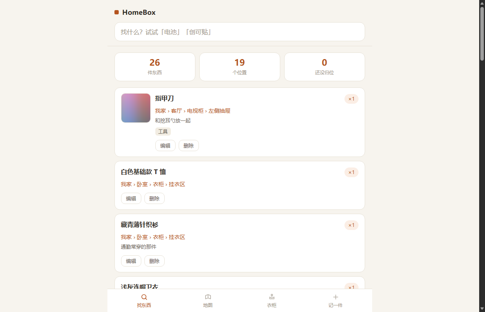
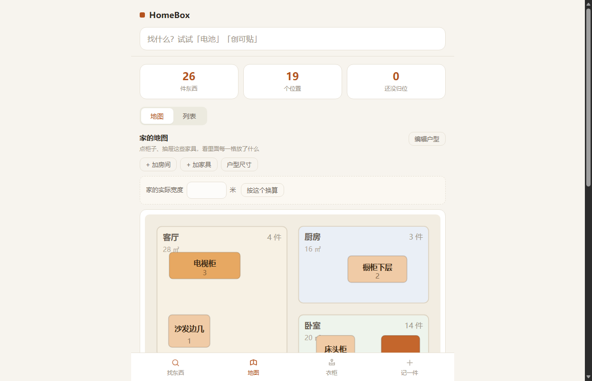
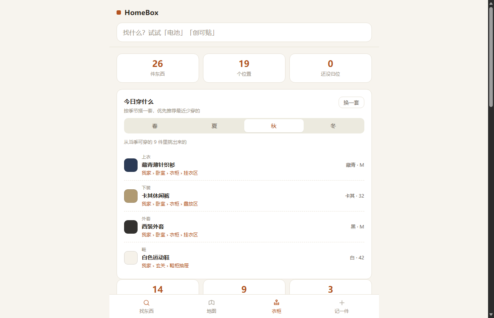

# HomeBox

一个跑在家里局域网的收纳检索工具。核心目的只有一个：**想找东西的时候，一秒查到它在哪。**

技术上刻意做得极简——零依赖（只用 Node 内置模块）、单文件数据库、没有构建步骤。可以拷到任何一块树莓派、香橙派或者旧笔记本上跑起来，装好之后家里所有设备都能用。

## 它能做什么

| | |
| --- | --- |
| **一秒找到东西** | 搜关键词，直接告诉你 `客厅 › 电视柜 › 左侧抽屉`，并且列出这个柜子里还有什么 |
| **家的地图** | 俯视平面图，家具位置可以自己拖，颜色深浅代表那里塞了多少东西；点进一件家具能看到它内部每个抽屉 |
| **衣柜** | 「今天穿什么」自动搭一套，优先推荐最近穿得少的；按季节 / 颜色 / 类别筛选 |
| **物品照片** | 说得出样子叫不出名字的东西，拍张照，找的时候看一眼图 |
| **加到手机桌面** | 安卓「添加到主屏幕」、iPhone 分享菜单，加完跟原生 App 没差别，全屏、无地址栏 |

所有数据只存在你自己家里的那台机器上，不经过任何服务器。

## 看起来像这样

| 搜索：一秒找到东西在哪 | 家的地图：可视化收纳 |
| --- | --- |
|  |  |

| 衣柜：今天穿什么 |
| --- |
|  |

## 快速开始（先在电脑上试一下）

只需要 Node 16 以上，不用装任何依赖、不用打包：

```bash
git clone https://github.com/1606701/HomeBox.git
cd HomeBox
node server.js
```

然后打开 <http://127.0.0.1:8080>。第一次启动会自动生成 `data/db.json`，里面有一份示例数据，随便改。

想让同一个 WiFi 下的手机也访问：

```bash
# macOS / Linux
HOST=0.0.0.0 node server.js

# Windows PowerShell
$env:HOST="0.0.0.0"; node server.js
```

控制台会打印地址，手机浏览器访问 `http://你的电脑IP:8080` 即可。

> 换端口用 `PORT=3000 node server.js`。默认只监听 `127.0.0.1`（只有本机能访问），这是刻意的——要开放给局域网必须显式声明 `HOST=0.0.0.0`。

## 装到树莓派 / 香橙派上

这部分两台机器完全通用，区别只有用户名（树莓派默认是 `pi`，香橙派默认是 `orangepi`）。

### 1. 确认 Node 版本

```bash
node -v
```

**必须是 v16 以上。** 这里有个坑：Debian 旧版本（bullseye）用 `apt install nodejs` 装出来的是 v12，跑不起来。

够新就直接装：

```bash
sudo apt update
sudo apt install -y nodejs
```

版本太旧或者还没装，用 NodeSource 拿一个正式的 LTS：

```bash
curl -fsSL https://deb.nodesource.com/setup_lts.x | sudo -E bash -
sudo apt install -y nodejs
node -v   # 应该是 v20.x 之类的
```

### 2. 把代码放上去

```bash
git clone https://github.com/1606701/HomeBox.git ~/HomeBox
cd ~/HomeBox
```

没有 git 或者网络不通，也可以在本机打包后用 scp 传：

```bash
scp -r HomeBox orangepi@192.168.1.50:~/
```

### 3. 跑起来

```bash
cd ~/HomeBox
HOST=0.0.0.0 PORT=8080 node server.js
```

此时家里任意设备打开 `http://192.168.1.50:8080` 就能用。

**建议去路由器里给这台机器绑一个静态 IP**（一般在 DHCP 静态地址分配里按 MAC 绑定），否则某天重启后 IP 变了，手机上的快捷方式就打不开了。

如果打不开，多半是被防火墙挡了，放行一下端口：

```bash
sudo ufw allow 8080/tcp   # 用了 ufw 的话
```

### 开机自启

新建 `/etc/systemd/system/homebox.service`：

```ini
[Unit]
Description=HomeBox 家庭收纳
After=network.target

[Service]
Type=simple
User=orangepi
WorkingDirectory=/home/orangepi/HomeBox
Environment=HOST=0.0.0.0
Environment=PORT=8080
ExecStart=/usr/bin/node server.js
Restart=always
RestartSec=3

[Install]
WantedBy=multi-user.target
```

然后：

```bash
sudo systemctl daemon-reload
sudo systemctl enable homebox
sudo systemctl start homebox
sudo systemctl status homebox
```

两个容易踩的点：

- `User=` 和 `WorkingDirectory=` 要换成你自己的用户名（树莓派是 `pi`，香橙派是 `orangepi`）。
- `ExecStart=` 的路径可能不是 `/usr/bin/node`，用 `which node` 查一下实际位置再填。

日常这几条够用了：

```bash
sudo systemctl restart homebox     # 改完代码重启
sudo journalctl -u homebox -f      # 看实时日志
sudo systemctl stop homebox        # 停掉
```

### 升级

代码更新不会影响你的数据（数据在 `data/` 里，不在版本库里）：

```bash
cd ~/HomeBox
git pull
sudo systemctl restart homebox
```

### 加到手机桌面

- **安卓 / Chrome**：打开页面，右上角菜单里选「添加到主屏幕」，之后图标和原生 App 几乎一样。
- **iPhone / Safari**：分享按钮 → 「添加到主屏幕」。

加完之后，找东西就是：解锁 → 点图标 → 输入关键词。

## 自动备份

数据全在 `data/db.json` 这一个文件里，备份极其简单。每天凌晨三点打包一次到另一个目录：

```bash
crontab -e
# 加这一行
0 3 * * * cd /home/orangepi/HomeBox && tar czf /home/orangepi/backup/homebox-$(date +\%Y\%m\%d).tar.gz data/
```

保留最近 30 天：

```bash
0 4 * * * find /home/orangepi/backup -name 'homebox-*.tar.gz' -mtime +30 -delete
```

> 注意：要真正安全，备份的目标位置不能和源在同一块卡上。香橙派的 TF 卡是整个系统里最可能先坏的东西，建议拷到 NAS、U 盘或者干脆 rsync 到你的电脑。
>
> 加了照片之后 `data/` 会明显变大，全量打包一天一次也够用。想更省可以用 `rsync -a --delete data/ 目标位置/`，只传变化的部分，照片这种只增不减的文件尤其合适。

## 给物品加照片

找东西时经常说得出样子、叫不出名字，这时候一张照片顶十句描述。

「记一件」和衣柜的「添一件衣服」里都有照片区：

- **拍照**：直接叫起手机后置摄像头（`capture="environment"`）。
- **从相册选**：从已有照片里挑。
- 选好之后会先显示预览，确认没问题再保存。列表里每张卡片左边会出现缩略图，**点一下看大图**。

几个实现上的取舍：

**图片在前端就先压缩过。** 手机直出的照片动辄三四千像素、好几 MB，浏览器会先把它画到 canvas 上缩到长边 1280 再转成 JPEG（质量 0.82），通常能压到原来的十分之一以下，肉眼看不出差别，但香橙派的 TF 卡会轻松很多。

**图片存独立文件，不塞进 `db.json`。** 文件放在 `data/photos/` 下，数据库里只留一个文件名。这样数据文件不会被几千张图撑大到读不动，备份时也好分别处理。

**服务端不看文件名，直接读文件头判断图片类型。** 即使有人把一段脚本改名成 `.jpg` 传上来也会被拒掉，只认真正的 jpg / png / webp。单张超过 6MB、或整个请求超过 9MB 会被拒绝并给出提示。

**换照片会删掉旧的，删物品也会连带删照片**，不会在卡里留下一堆孤儿文件。

> **关于拍照按钮**：`<input type="file">` 在 HTTP 页面里是能调起摄像头的，但各家浏览器对「直接拍照」的限制一直在变。如果发现「拍照」按钮没反应，**用「从相册选」一定可以**——先在系统相机里拍，再进相册选这张。想让拍照始终可靠，可以给香橙派配个 HTTPS（Tailscale 加自签证书是最省事的路子）。

### 改完代码，前端没变化怎么办

浏览器有 Service Worker 缓存，**曾经吃过一次亏**：旧版本的 SW 会一直把它的 `app.js` 还给你，部署了新功能却死活看不到。

现在做了三重保险，正常情况刷新一次就会自动更新。但如果还是怀疑上了旧版本，**看页面最下面那行小字**——那里写着当前的前端资源版本（比如 `前端资源 v6`）。只要它不是你要的版本，按 `Ctrl+Shift+R`（Mac 是 `Cmd+Shift+R`）硬刷新一次即可，开无痕窗口也一定能拿到最新的。

> **改动前端后的发布约定**：`public/index.html` 里引用的 `style.css?v=N` 和 `app.js?v=N`，以及 `public/app.js` 顶部的 `APP_VERSION`，三者必须同步 +1。漏掉这一步，浏览器可能继续用缓存里的旧资源。

## 按自己家的样子改户型

示例数据里的「一房一厅」只是个起点，**户型是完全可编辑的**，不是写死的模板。

在「地图」页点右上角 **编辑户型**：

| 想做什么 | 怎么操作 |
| --- | --- |
| 加房间 | 点「+ 加房间」，它会自己找个空位落下，然后在下面的面板里改成你要的名字 |
| 加家具 / 收纳位 | 选中一个房间后点「+ 加家具」，会落在这个房间里 |
| 改名字 | 在地图上点中它，在下面的面板里改，点保存 |
| 改大小 | 拖它右下角的方块，或者在面板里直接填宽高 |
| 挪位置 | 按住拖到想去的地方，松手自动保存 |
| 挪到别的房间 | 直接把家具拖到另一个房间上，松手后归属会自动改过去 |
| 删掉 | 选中后点面板里的「删除」。里面的东西不会被删，只是变成「未归档」 |
| 格子改名 / 删除 | 编辑模式下点进家具内部，点某个格子即可改名，角上的 × 是删除 |

上方的「户型尺寸」用来填**家的实际宽度（米）**，填完之后每个房间会显示真实面积（比如 18 ㎡）。这个数字只影响面积换算，不影响任何功能。

坐标记在 `location.box` 里，是一套 100 × 88 的相对坐标，房间和家具共用，所以拖出来的比例就是你看图的比例。

## 数据说明

`data/db.json` 结构非常简单，可以直接用文本编辑器查看和修改：

```json
{
  "version": 2,
  "settings":  { "planWidthM": 12 },
  "locations": [{ "id": "l_living", "name": "客厅", "parent": "l_home",
                  "kind": "room", "box": { "x": 4, "y": 4, "w": 44, "h": 44 } }],
  "items":     [{ "id": "i_xxx", "name": "指甲刀", "locId": "l_tvdrawer", "qty": 1, "tags": ["工具"] }]
}
```

`locations` 通过 `parent` 串成一棵树，`items.locId` 指向这棵树上的某个节点。`kind` 有四种：`home`（家）／`room`（房间）／`furniture`（家具）／`compartment`（抽屉、隔层这类格子）。

衣服不单独建表，是普通物品多挂了一个 `wear` 字段（`{ type, seasons, colors, size, status, wearCount, lastWorn }`）。这样衣服也能被全局搜索到，位置逻辑完全复用。

有照片的物品会多一个 `photo` 字段，值是 `data/photos/` 下的文件名：

```json
{ "id": "i_xxx", "name": "指甲刀", "locId": "l_tvdrawer", "photo": "p_ab12cd.jpg" }
```

服务器每次写入都采用「先写临时文件再改名」的原子操作，避免写到一半断电把文件写坏。照片不属于关键数据（写坏了重新拍一张就是），所以是直写的，不做这层保护。

## 接口

| 方法 | 路径 | 说明 |
| --- | --- | --- |
| GET | `/api/locations` | 返回位置树（每节点带 `itemCount` / `totalCount`）与 `settings` |
| POST | `/api/locations` | 新建位置，body：`{ name, parent, kind }`。房间和家具会自动分配可见的初始坐标 |
| PUT | `/api/locations/:id` | 更新 `name` / `box` / `parent` / `kind`。改 parent 会做防环校验 |
| DELETE | `/api/locations/:id` | 删除位置及其子位置，其中的物品降级为「未归档」 |
| PUT | `/api/settings` | 更新 `{ planWidthM }`，用于面积换算 |
| GET | `/api/items?q=关键词` | 搜索物品，每项带完整路径 `path` |
| POST | `/api/items` | 新增物品，body：`{ name, locId, qty, tags, note, wear }` |
| PUT | `/api/items/:id` | 更新物品。不带 `wear` 字段时不会动到衣物属性 |
| DELETE | `/api/items/:id` | 删除物品（连带删掉它的照片文件） |
| POST | `/api/items/:id/photo` | 上传照片，body：`{ data: "<base64 或整条 dataURL>" }`。服务端按文件头判断类型，落在 `data/photos/` 下 |
| DELETE | `/api/items/:id/photo` | 只删照片，物品保留 |
| GET | `/photos/:文件名` | 取照片本体，带一年长缓存（离线也能看） |
| GET | `/api/wardrobe` | 全部衣物 + 各维度分面统计 |
| GET | `/api/wardrobe/suggest?season=` | 按季节推荐一套搭配，优先推最近少穿的 |
| POST | `/api/items/:id/wear` | 记录「今天穿了」，默认转为待洗；`{ undo: true }` 可撤销 |
| POST | `/api/wardrobe/demo` | 一键导入示例衣物，按现有位置结构柔性匹配 |

有了这套接口，后面想做别的前端（比如一个真正的鸿蒙原生 App）只需要连它就行，数据层不用重写。

## 还能往哪走

按「先解决真问题，再加装饰」的顺序：

1. **二维码**：把每个收纳位置的链接生成二维码，贴在对应的柜门上。扫一下直接列出这个柜子里有什么，不用在手机上翻树。
2. **有效期提醒**：给药品、食品加过期日期，首页显示快过期的清单。
3. **本地图像识别**：香橙派 AI Pro 那块昇腾 NPU 到现在还闲着。接一个本地模型，拍照自动识别「这是什么东西」并填好名称和分类，照片不出家门。
4. **3D 微缩视图**：最后再考虑。用 Three.js 在浏览器里画一个家的小模型，从物品点进去高亮位置。视觉效果最好，但对「找东西」的实际帮助有限——搜索和二维码更实在。
5. **外网访问**：不想折腾的话装个 Tailscale，比端口映射安全得多，不用把家里的服务暴露到公网上。顺带解决上一条拍照按钮的 HTTPS 问题。

## 安全提醒

这个服务**没有做登录鉴权**。放在家里局域网内是合适的——能连上你家 WiFi 的人本来就是能信的人。但请不要直接把它端口映射到公网上。如果确实需要在外面访问，用 Tailscale 这类组网工具。

## 项目结构

```
HomeBox/
├── server.js          # 全部后端：HTTP 服务、API、静态资源、照片存取
├── public/
│   ├── index.html     # 单页结构
│   ├── app.js         # 前端逻辑（原生 JS，无框架、无构建）
│   ├── style.css
│   ├── sw.js          # Service Worker，离线也能用
│   ├── manifest.webmanifest   # 加到手机桌面用
│   └── favicon.svg
├── data/              # 运行时生成，不在版本库里
│   ├── db.json        # 全部数据，就这一个文件
│   └── photos/        # 物品照片
└── package.json       # 声明了 npm start，实际零依赖
```

## 参与改动

改前端之后有三处版本号必须同步 +1，否则浏览器可能继续用缓存里的旧资源：`public/index.html` 里的 `style.css?v=N`、`app.js?v=N`，以及 `public/app.js` 顶部的 `APP_VERSION`。详见上面「改完代码，前端没变化怎么办」。

## 许可证

MIT。随便改、随便用，商用也行，不用署名。
